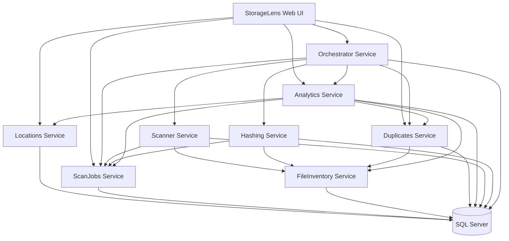

# Microservices Architecture

## Service Boundaries

StorageLens separates UI, orchestration, domain persistence, and compute-heavy stages into focused services.

## Service Responsibilities

- `StorageLens.Web`
  - User-facing interface for locations, scans, analytics, and duplicate views
  - Calls backend services through typed API clients
- `Locations Service`
  - Manages storage location metadata and status
- `ScanJobs Service`
  - Owns scan job lifecycle state, progress counters, and stage transitions
- `FileInventory Service`
  - Persists file metadata and hash/duplicate status
  - Supports batch ingest and hash update operations
- `Duplicates Service`
  - Computes duplicate groups from file hashes
  - Produces duplicate summary metrics
- `Analytics Service`
  - Aggregates cross-service data into dashboard/report DTOs
- `Scanner Service`
  - Enumerates files from target paths
  - Pushes metadata batches to FileInventory and scan progress to ScanJobs
- `Hashing Service`
  - Fetches pending files and computes SHA-256 hashes
  - Posts hash results and progress updates
- `Orchestrator Service`
  - Coordinates the end-to-end workflow
  - Manages retry/resume and workflow state tracking

## Data Ownership

Each service owns its schema and persistence model:
- `locations`
- `scanjobs`
- `fileinventory`
- `duplicates`
- `analytics`
- `scanner`
- `hashing`
- `orchestration`

No service writes directly to another service database.

## Service Communication Model

- Synchronous HTTP calls using service-specific clients
- Contract sharing through `StorageLens.Shared.Contracts`
- Correlation IDs propagated across scan workflow stages
- Health probes via `/health` endpoints

## Architecture Diagram

