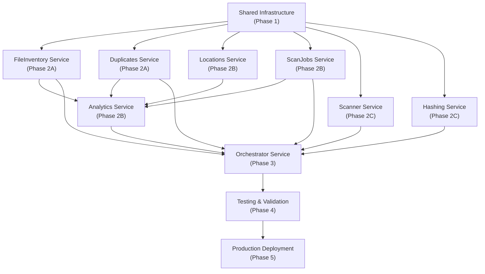

# Implementation Roadmap

## Executive Summary

**Phase 2** of StorageLens code quality improvements will systematically apply the four strategy documents (Error Handling, Logging, Configuration, Performance) across all 8 microservices.

**Timeline**: 6 weeks total  
**Target Code Quality**: 7.5/10 → 9.5/10  
**Team Effort**: ~160 hours across entire backend team  
**Breaking Changes**: Minimal (API response format changes are additive)

---

## Phase Overview

| Phase | Focus | Services | Duration | Effort |
|-------|-------|----------|----------|--------|
| **Phase 1** | Shared Infrastructure | 2 days | 20 hrs |
| **Phase 2A** | Critical Path Services | Duplicates, FileInventory | 1 week | 40 hrs |
| **Phase 2B** | High-Traffic Services | Locations, ScanJobs, Analytics | 1 week | 40 hrs |
| **Phase 2C** | Compute Services | Scanner, Hashing | 1 week | 30 hrs |
| **Phase 3** | Orchestrator Integration | Orchestrator | 3 days | 20 hrs |
| **Phase 4** | Testing & Validation | All services | 1 week | 40 hrs |
| **Phase 5** | Deployment & Monitoring | All services | 2 days | 10 hrs |

---

## Phase 1: Shared Infrastructure (Week 1, Monday-Tuesday)

### Objective
Build reusable components for all services. No service-specific code.

### Deliverables

#### 1.1 Error Handling Infrastructure
**File**: `src/StorageLens.Shared.Infrastructure/ErrorHandling/`

```
✓ ErrorResponseDto.cs
✓ GlobalExceptionHandlerMiddleware.cs
✓ Exception base classes (ValidationException, ResourceNotFoundException, etc.)
✓ ErrorHandlingExtensions.cs (middleware registration)
```

**Effort**: 4 hours  
**Owner**: Senior Backend Engineer  
**Acceptance Criteria**:
- [ ] All exception types compile
- [ ] Middleware can be registered in Program.cs
- [ ] Unit tests for exception mapping

#### 1.2 Logging Infrastructure
**File**: `src/StorageLens.Shared.Infrastructure/Logging/`

```
✓ CorrelationIdMiddleware.cs
✓ CorrelationIdAccessor.cs
✓ HttpRequestLoggingMiddleware.cs
✓ SensitiveDataSanitizer.cs
✓ LoggingExtensions.cs
```

**Effort**: 6 hours  
**Owner**: Senior Backend Engineer  
**Acceptance Criteria**:
- [ ] Correlation IDs propagate through HttpContext
- [ ] Sensitive data is sanitized in logs
- [ ] Request/response times are logged

#### 1.3 Configuration Infrastructure
**File**: `src/StorageLens.Shared.Infrastructure/Configuration/`

```
✓ IValidatableOptions.cs
✓ ValidateOptionsStartupFilter.cs
✓ ConfigurationExtensions.cs
```

**Effort**: 3 hours  
**Owner**: Senior Backend Engineer  
**Acceptance Criteria**:
- [ ] Options validation runs at startup
- [ ] Fails fast with clear error messages
- [ ] Works with dependency injection

#### 1.4 Performance Helpers
**File**: `src/StorageLens.Shared.Infrastructure/Performance/`

```
✓ QueryInterceptor.cs (for testing query count)
✓ N+1 Detection utilities
```

**Effort**: 3 hours  
**Owner**: Backend Engineer  
**Acceptance Criteria**:
- [ ] Query count can be monitored in tests
- [ ] Performance traces are clear

#### 1.5 Update Shared.Contracts
**File**: `src/StorageLens.Shared.Contracts/`

```
✓ Add ErrorResponseDto record
✓ Add error code enums/constants
```

**Effort**: 2 hours  
**Owner**: Backend Engineer

**Status**: ❌ NOT STARTED

---

## Phase 2A: Critical Path Services (Week 2, Mon-Fri)

**Why First**: Duplicates and FileInventory have acknowledged N+1 issues and are called by Analytics and Orchestrator.

### Service 1: Duplicates Service

**Effort**: 20 hours  
**Owner**: Senior Backend Engineer + 1 Backend Engineer  
**Timeline**: Wednesday-Thursday (3 days)

#### Subtasks

**2A.1.1 Error Handling** (4 hours)
- [ ] Add service-specific DuplicatesServiceException class
- [ ] Add error codes (DUPLICATES_NOT_FOUND, CALCULATION_FAILED, etc.)
- [ ] Update DuplicatesController to throw exceptions
- [ ] Update DuplicatesService to throw exceptions instead of returning nulls
- [ ] Unit tests for error scenarios (404, 500, etc.)

**2A.1.2 Logging** (4 hours)
- [ ] Inject ICorrelationIdAccessor in controller and service
- [ ] Add information-level logs to GetSummaryAsync, RecalculateAsync
- [ ] Add debug-level logs to repository queries
- [ ] Add sensitive data sanitization (no file paths in logs)
- [ ] Unit tests verify correlation ID in logs

**2A.1.3 Configuration** (3 hours)
- [ ] Create DuplicatesServiceOptions class
- [ ] Add validation for HttpTimeout, MaxGroups, etc.
- [ ] Update appsettings.json with defaults
- [ ] Update Program.cs to bind and validate options
- [ ] Unit tests for configuration validation

**2A.1.4 Performance (Fix N+1)** (6 hours)
- [ ] Fix GetSummaryAsync pagination (TODO comment replacement)
- [ ] Add integration test to verify single HTTP call per page
- [ ] Review HTTP client for query efficiency
- [ ] Update CHANGELOG with N+1 fix
- [ ] Performance tests validate timing

**2A.1.5 Testing & Documentation** (3 hours)
- [ ] Update unit tests for new error handling
- [ ] Document service-specific error codes
- [ ] Update API docs with new error response format
- [ ] PR review and merge

---

### Service 2: FileInventory Service

**Effort**: 20 hours  
**Owner**: Backend Engineer + 1 Junior Backend Engineer  
**Timeline**: Friday-Monday (3 days)

#### Subtasks

**2A.2.1 Error Handling** (3 hours)
- [ ] Add FileInventoryServiceException class
- [ ] Update FileInventoryController error responses
- [ ] Update FileInventoryService to throw exceptions
- [ ] Unit tests for error scenarios

**2A.2.2 Logging** (3 hours)
- [ ] Inject ICorrelationIdAccessor
- [ ] Add logs to GetFilesByLocationAsync, UpsertBatchAsync
- [ ] Add repository-level debug logging
- [ ] Sanitize file paths in logs

**2A.2.3 Configuration** (2 hours)
- [ ] Create FileInventoryServiceOptions
- [ ] Add batch size, timeout, query settings
- [ ] Update Program.cs

**2A.2.4 Performance (Fix N+1 & ExecuteUpdate)** (7 hours)
- [ ] **CRITICAL**: Fix MarkDuplicateFlagsByHashAsync using ExecuteUpdateAsync
- [ ] **CRITICAL**: Fix UpsertBatchAsync with batch processing
- [ ] Add query interceptor to tests
- [ ] Performance baseline tests (5 sec timeout for 10K records)
- [ ] Update CHANGELOG

**2A.2.5 Testing & Documentation** (2 hours)
- [ ] Update integration tests
- [ ] Documentation updates

---

## Phase 2B: High-Traffic Services (Week 3, Mon-Fri)

**Why Next**: These services handle user-facing requests and are called frequently.

### Service 3: Locations Service

**Effort**: 12 hours  
**Owner**: Backend Engineer  
**Timeline**: Monday-Tuesday (2 days)

#### Subtasks (Parallel with Analytics)

**2B.1.1 Error Handling** (2 hours)
**2B.1.2 Logging** (2 hours)
**2B.1.3 Configuration** (2 hours)
**2B.1.4 Performance Review** (2 hours) - No N+1 expected
**2B.1.5 Testing & Documentation** (2 hours)

---

### Service 4: ScanJobs Service

**Effort**: 12 hours  
**Owner**: Backend Engineer  
**Timeline**: Tuesday-Wednesday (2 days)

#### Subtasks (Parallel with Locations)

**2B.2.1 Error Handling** (2 hours)
**2B.2.2 Logging** (2 hours)
**2B.2.3 Configuration** (2 hours)
**2B.2.4 Performance Review** (2 hours)
**2B.2.5 Testing & Documentation** (2 hours)

---

### Service 5: Analytics Service

**Effort**: 16 hours  
**Owner**: Senior Backend Engineer  
**Timeline**: Wednesday-Friday (3 days)

**Dependencies**: Requires FileInventory service ready (called via HTTP)

#### Subtasks

**2B.3.1 Error Handling** (3 hours)
**2B.3.2 Logging with Correlation ID** (4 hours) - Complex cross-service logging
**2B.3.3 Configuration** (2 hours)
**2B.3.4 Performance** (4 hours)
- [ ] Review HTTP calls to dependent services
- [ ] Verify includes/excludes for data fetching
- [ ] Optimize dashboard KPI calculation
**2B.3.5 Testing & Documentation** (3 hours)

---

## Phase 2C: Compute Services (Week 4, Mon-Fri)

**Why Later**: These services run in background jobs, less urgent than user-facing services.

### Service 6: Scanner Service

**Effort**: 14 hours  
**Owner**: Backend Engineer + Junior  
**Timeline**: Monday-Wednesday (2.5 days)

#### Subtasks

**2C.1.1 Error Handling** (2 hours)
**2C.1.2 Logging** (4 hours) - Must NOT log sensitive file paths
**2C.1.3 Configuration** (2 hours)
**2C.1.4 Performance** (3 hours) - Add batch processing timeouts
**2C.1.5 Testing & Documentation** (3 hours)

---

### Service 7: Hashing Service

**Effort**: 14 hours  
**Owner**: Backend Engineer  
**Timeline**: Wednesday-Friday (2.5 days)

#### Subtasks

**2C.2.1 Error Handling** (2 hours)
**2C.2.2 Logging** (4 hours) - File path hashing for privacy
**2C.2.3 Configuration** (2 hours) - Health check, hashing timeout
**2C.2.4 Performance** (3 hours)
**2C.2.5 Testing & Documentation** (3 hours)

---

## Phase 3: Orchestrator Service (Week 5, Mon-Wed)

**Why Last**: Depends on other services being upgraded.

**Effort**: 20 hours  
**Owner**: Senior Backend Engineer  
**Timeline**: Monday-Wednesday (3 days)

#### Subtasks

**3.1 Error Handling** (4 hours)
- [ ] Workflow-specific error codes
- [ ] Handle errors from all dependent services

**3.2 Logging** (6 hours) - Most complex logging (multi-step workflow, retries)
- [ ] Correlation ID through workflow steps
- [ ] Step entry/exit logging
- [ ] Retry attempt logging

**3.3 Configuration** (2 hours)
- [ ] Workflow retry policies from config
- [ ] Timeout settings per step

**3.4 Performance** (4 hours)
- [ ] Verify efficient service calls
- [ ] HTTP client timeout handling

**3.5 Testing & Documentation** (4 hours)

---

## Phase 4: Testing & Validation (Week 5-6, Thu-Fri + Mon-Fri)

**Objective**: Comprehensive testing across all services.

**Effort**: 40 hours  
**Owner**: QA Lead + 2 Test Engineers  
**Timeline**: Thursday-Friday + full week

### 4.1 Integration Testing (12 hours)
- [ ] Cross-service error propagation tests
- [ ] Correlation ID tracing through entire workflow
- [ ] Performance tests with realdata volumes

### 4.2 Error Scenario Testing (8 hours)
- [ ] Test all error codes return correct HTTP status
- [ ] Test error responses match schema
- [ ] Test error instance IDs are unique

### 4.3 Logging Testing (12 hours)
- [ ] Verify correlation IDs in all logs
- [ ] Verify no sensitive data in logs
- [ ] Performance logging is accurate

### 4.4 Configuration Testing (8 hours)
- [ ] Validation fails for invalid configs
- [ ] Environment-specific configs load correctly
- [ ] Key Vault secrets are used in production

---

## Phase 5: Deployment & Monitoring (Week 6, Monday-Tuesday)

**Effort**: 10 hours  
**Owner**: DevOps + Senior Backend Engineer

### 5.1 Pre-Deployment Checklist (2 hours)
- [ ] All unit tests pass (8 services)
- [ ] All integration tests pass
- [ ] Code review completed
- [ ] CHANGELOG updated
- [ ] API documentation updated

### 5.2 Staging Deployment (4 hours)
- [ ] Deploy to staging environment
- [ ] Run smoke tests
- [ ] Verify error responses in staging
- [ ] Check application insights logs

### 5.3 Production Deployment (2 hours)
- [ ] Blue-green deployment
- [ ] Monitor error rates
- [ ] Verify correlation IDs in production logs

### 5.4 Monitoring Setup (2 hours)
- [ ] Alert on high error rates
- [ ] Alert on N+1 detected patterns
- [ ] Dashboard for code quality metrics

---

## Dependencies Between Services



---

## Resource Allocation

### Team Composition
- **1 Senior Backend Engineer** (Lead, Complex services)
- **3 Backend Engineers** (Core implementation)
- **2 Junior Backend Engineers** (Testing, documentation)
- **1 QA Lead** (Test strategy)
- **1 DevOps Engineer** (Deployment)

### Time Investment by Person

| Role | Phase 1 | Phase 2A | Phase 2B | Phase 2C | Phase 3 | Phase 4 | Phase 5 | Total |
|------|---------|---------|---------|---------|---------|---------|---------|-------|
| Senior | 15 hrs | 10 hrs | 4 hrs | 0 hrs | 20 hrs | 5 hrs | 2 hrs | 56 hrs |
| Backend #1 | 3 hrs | 20 hrs | 12 hrs | 7 hrs | 0 hrs | 8 hrs | 1 hr | 51 hrs |
| Backend #2 | 2 hrs | 0 hrs | 12 hrs | 7 hrs | 0 hrs | 8 hrs | 1 hr | 30 hrs |
| Backend #3 | 2 hrs | 0 hrs | 8 hrs | 8 hrs | 0 hrs | 8 hrs | 1 hr | 27 hrs |
| Junior #1 | 0 hrs | 0 hrs | 0 hrs | 4 hrs | 0 hrs | 12 hrs | 0 hrs | 16 hrs |
| Junior #2 | 0 hrs | 0 hrs | 0 hrs | 4 hrs | 0 hrs | 12 hrs | 0 hrs | 16 hrs |
| QA | 0 hrs | 2 hrs | 2 hrs | 2 hrs | 2 hrs | 40 hrs | 2 hrs | 50 hrs |
| DevOps | 0 hrs | 0 hrs | 0 hrs | 0 hrs | 0 hrs | 0 hrs | 10 hrs | 10 hrs |
| **Total** | **22 hrs** | **32 hrs** | **38 hrs** | **32 hrs** | **22 hrs** | **93 hrs** | **17 hrs** | **256 hrs** |

---

## Risk Mitigation

### Risk 1: API Response Format Changes Break Clients
**Mitigation**:
- [ ] API is additive (new ErrorResponseDto field added)
- [ ] Old response format still accepted during transition
- [ ] Web UI updated before services deployed

### Risk 2: Configuration Migration Errors
**Mitigation**:
- [ ] Validation at startup catches issues immediately
- [ ] Key Vault secrets tested in staging
- [ ] Rollback plan: keep old configuration with feature flag

### Risk 3: Performance Regressions
**Mitigation**:
- [ ] Performance tests with real data volumes
- [ ] Baseline measurements before/after
- [ ] Query interception logging in staging

### Risk 4: Logging Overhead
**Mitigation**:
- [ ] Profile logging overhead in staging
- [ ] Use conditional compilation for debug logs
- [ ] Lazy evaluation for expensive operations

---

## Success Metrics

### Pre-Implementation (Baseline)
- [ ] Code Quality Score: **7.5/10**
- [ ] Error Response Consistency: **30%** (some services)
- [ ] Correlation ID Usage: **40%** (inconsistent)
- [ ] Configuration Type Safety: **50%** (mix of typed and magic strings)
- [ ] N+1 Query Issues: **3 identified** (Duplicates, FileInventory)

### Post-Implementation (Target)
- [ ] Code Quality Score: **9.5/10**
- [ ] Error Response Consistency: **100%** (all services)
- [ ] Correlation ID Usage: **100%** (all layers)
- [ ] Configuration Type Safety: **100%** (all strongly-typed)
- [ ] N+1 Query Issues: **0 identified** (all fixed)
- [ ] Reflection Anti-patterns: **0 found** (all documented)

### Code Review Checklist

Before merging each service PR:

```
✓ Error handling: All controllers throw exceptions, no bare BadRequest
✓ Logging: Every info log has correlation ID
✓ Configuration: All hardcoded values moved to AppOptions
✓ Performance: No N+1 queries detected
✓ Tests: Unit tests for error, logging, config scenarios
✓ Documentation: API docs, README updated
✓ Backward Compatibility: No breaking changes
```

---

## Communication Plan

### Weekly Status Updates
- **Monday 10 AM**: Weekly standup (15 min) - All team members
- **Friday 2 PM**: Demo & blockers (30 min) - Senior engineer + QA lead

### PR Review Process
- **Every PR** must have 2 approvals before merge
- Target review time: **4 hours** (same day)
- Code review template:
  - [ ] Follows ErrorHandlingStrategy
  - [ ] Follows LoggingStrategy
  - [ ] Follows ConfigurationStrategy
  - [ ] Follows PerformancePatterns
  - [ ] Unit tests added
  - [ ] Documentation updated
  - [ ] CHANGELOG entry added

### Sprint Retrospective
- **End of Phase 4** (Friday of week 5)
- Review: What worked, what didn't, lessons learned
- Document for future improvements

---

## Appendix: Commit Message Template

```
[CODE-QUALITY] service_name: implement error-logging-config-performance

This commit applies four strategies to ParticularService:

1. Error Handling: 
   - Added ServiceException base class
   - Controllers throw exceptions instead of BadRequest
   - ErrorResponseDto returned with correlation ID

2. Logging:
   - Added correlation ID propagation
   - Structured logs with context
   - Sanitized sensitive data (file paths)

3. Configuration:
   - Created ServiceOptions class
   - Moved hardcoded defaults to appsettings.json
   - Added startup validation

4. Performance:
   - Fixed N+1 queries (if any found)
   - Optimized database queries
   - Added performance tests

See docs/strategies/ for implementation details.

Closes: #ISSUE_NUMBER
```

---

## Next Steps

1. **Week 1 Monday**: Kick-off meeting with all team members
2. **Week 1 Tuesday**: Approve Shared Infrastructure PR
3. **Week 2 Monday**: Start Phase 2A services on schedule
4. **Weekly**: Brief standups for blockers
5. **Week 5 Friday**: Full regression testing begins
6. **Week 6 Monday**: Production deployment

